

<a href="https://gopalnayak980.github.io/gopal-portfolio">
  
</a>

 

 

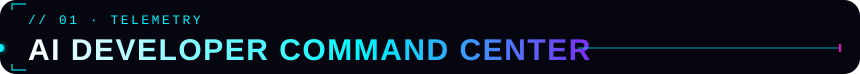

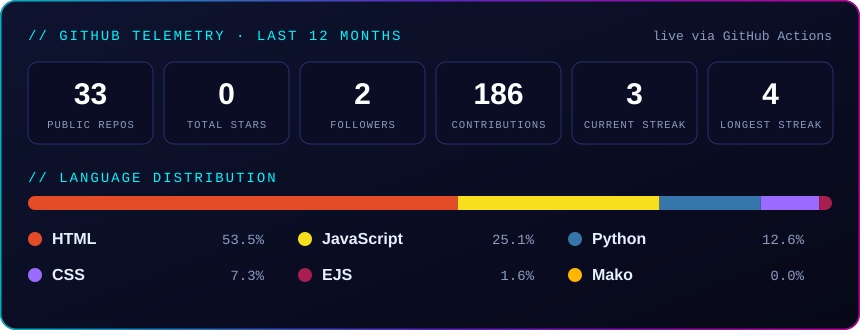

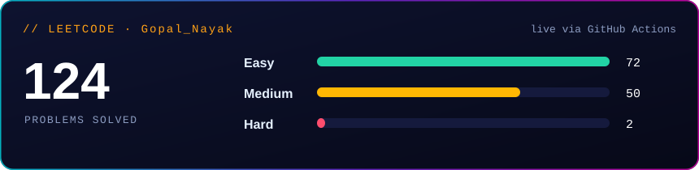

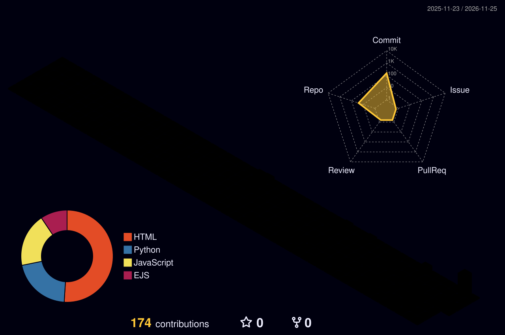

 

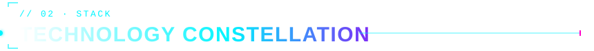


 

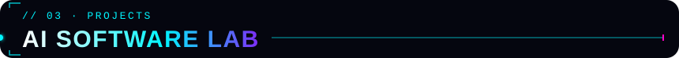

<a href="https://github.com/gopalnayak980/DevAgent">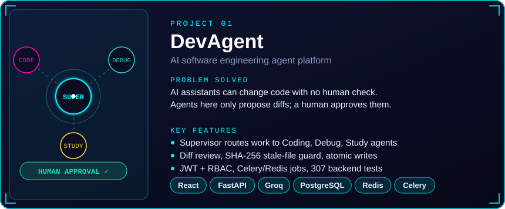</a>

**[Live demo](https://dev-agent-woad.vercel.app)** · **[Source code](https://github.com/gopalnayak980/DevAgent)**

<a href="https://github.com/gopalnayak980/hireai">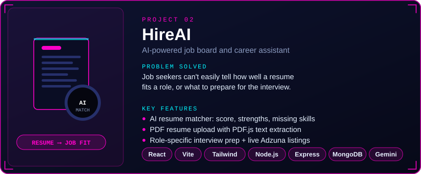</a>

**[Live demo](https://hireai-blond.vercel.app)** · **[Source code](https://github.com/gopalnayak980/hireai)**

<a href="https://github.com/gopalnayak980/jarvis-ai">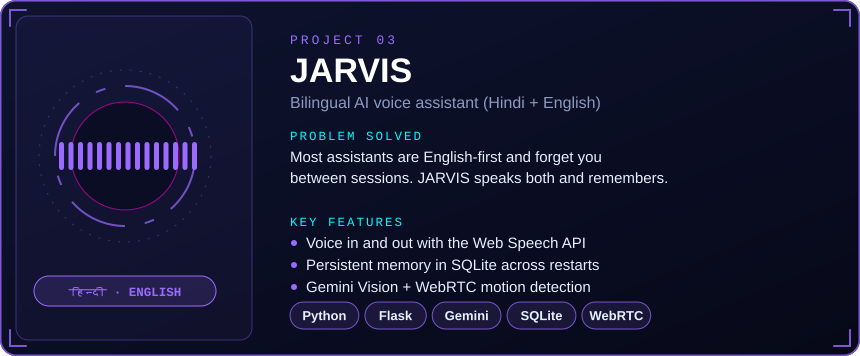</a>

**[Live demo](https://jarvis-ai-8zh0.onrender.com)** · **[Source code](https://github.com/gopalnayak980/jarvis-ai)**

<a href="https://github.com/gopalnayak980/wanderlist">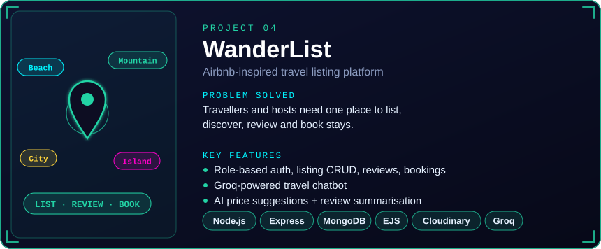</a>

**[Live demo](https://wanderlist-1-msxf.onrender.com)** · **[Source code](https://github.com/gopalnayak980/wanderlist)**

<a href="https://github.com/gopalnayak980/jai-mata-di-website">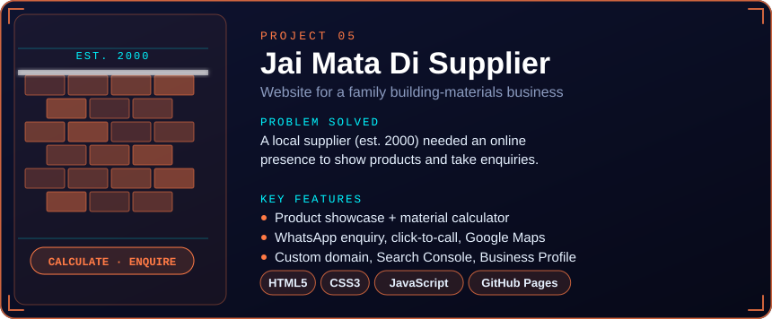</a>

**[Live website](https://jaimatadibuildingmaterial.com)** · **[Source code](https://github.com/gopalnayak980/jai-mata-di-website)**

> Free-tier hosting (Render): the first load of JARVIS and WanderList can take 30 to 50 seconds while the server wakes up.

 

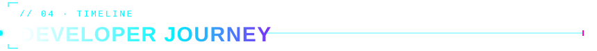

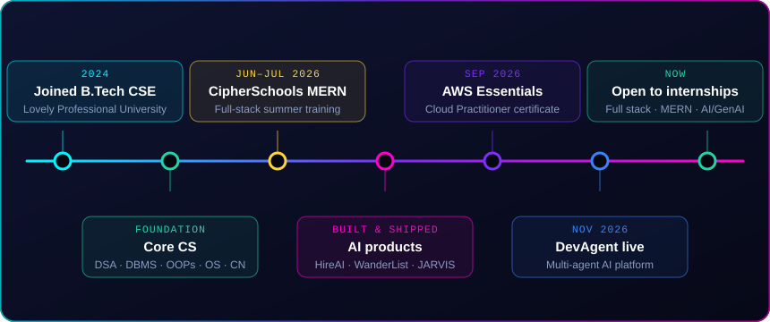

 

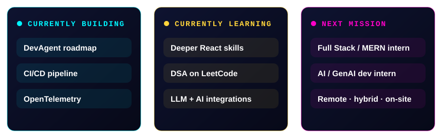

 

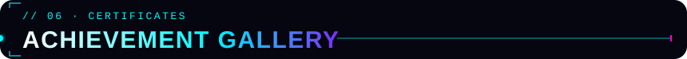

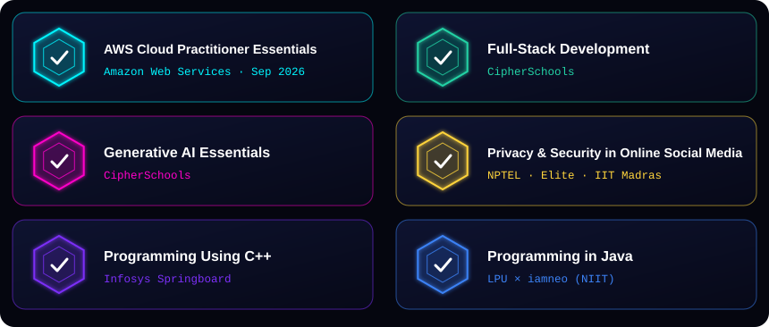

 

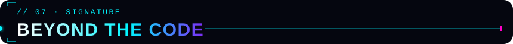


 

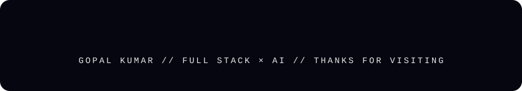
