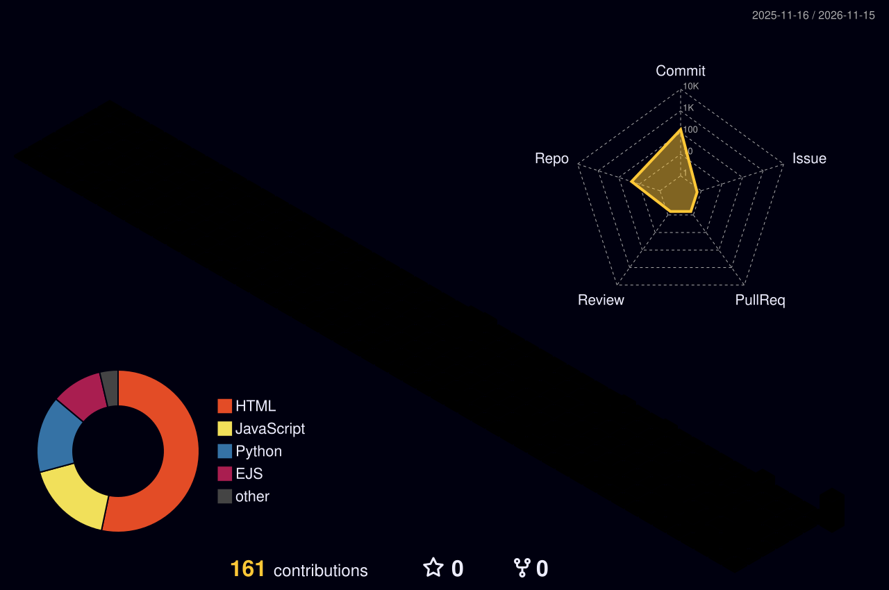

<div align="center">


<a href="https://gopalnayak980.github.io/gopal-portfolio">
  
</a>

<br/><br/>

[](https://gopalnayak980.github.io/gopal-portfolio)
[](https://www.linkedin.com/in/gopalnayak2005)
[](https://leetcode.com/u/Gopal_Nayak)
[](https://github.com/gopalnayak980)
[](mailto:gopal32452@gmail.com)


</div>

---

## `> whoami`

```bash
name       : Gopal Kumar
role       : Full Stack Developer (MERN + AI)
education  : B.Tech CSE @ Lovely Professional University (2024-2028)
focus      : AI agents, full stack web apps, real-world products
status     : open to internships
```

---

## `> tech_stack`

<div align="center">

**Frontend**<br/>


**Backend**<br/>


**Databases and Cloud**<br/>


**Tools**<br/>


</div>

---

## `> featured_projects`

| Project | What it does | Stack | Links |
|---|---|---|---|
| **DevAgent** | Multi-agent AI engineering platform with human-approved code changes | React, FastAPI, Groq, Celery, PostgreSQL | [Live](https://dev-agent-woad.vercel.app) · [Code](https://github.com/gopalnayak980/DevAgent) |
| **HireAI** | AI resume matcher and interview prep with live job listings | React, Node, MongoDB, Gemini | [Live](https://hireai-blond.vercel.app) · [Code](https://github.com/gopalnayak980/hireai) |
| **JARVIS** | Bilingual (Hindi and English) voice assistant with memory and vision | Flask, Gemini, SQLite, WebRTC | [Live](https://jarvis-ai-8zh0.onrender.com) · [Code](https://github.com/gopalnayak980/jarvis-ai) |
| **WanderList** | Airbnb-inspired travel listings with AI chatbot and price suggestions | Node, Express, MongoDB, Groq | [Live](https://wanderlist-1-msxf.onrender.com) · [Code](https://github.com/gopalnayak980/wanderlist) |
| **Jai Mata Di Supplier** | Business website with material calculator and WhatsApp enquiry | HTML, CSS, JavaScript | [Live](https://jaimatadibuildingmaterial.com) · [Code](https://github.com/gopalnayak980/jai-mata-di-website) |

---

## `> contributions_3d`

<div align="center">
  
</div>

---

## `> github_stats`

<div align="center">


</div>

---

## `> leetcode_stats`

<div align="center">
  <a href="https://leetcode.com/u/Gopal_Nayak">
    
  </a>
</div>

---

## `> trophies`

<div align="center">
  
</div>

---

<div align="center">
  
</div>


